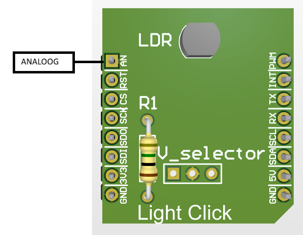

# myADC

Eenvoudige functies om een analoge spanning te meten met de ADC van de ESP32-S3 Mini.

## Het board




## Aansluitingen

Op het board (zie [myESP_S3_mini_board.h](../../boards/myESP_S3_mini_board/include/myESP_S3_mini_board.h)):

| Onderdeel | Pin | Define | ADC kanaal |
|---|---|---|---|
| Analoge ingang | GPIO 6 | `MB_ANA_PIN` | 5 |

* Sluit het signaal aan op de analoge pin en zorg voor een gemeenschappelijke GND.
* Hou de spanning binnen het meetbereik (zie hieronder) en nooit boven 3.3 V.
* Op ADC1 van de ESP32-S3 is kanaal 0..9 gelijk aan GPIO 1..10, dus kanaal = GPIO - 1.

## Hoe werkt het

Alle functies krijgen enkel het ADC kanaal mee.

| Functie | Uitleg |
|---|---|
| `myADC_setup(channel)` | Stelt het kanaal in en maakt de kalibratie aan. Eenmaal oproepen voor je meet |
| `myADC_readRaw(channel)` | Geeft de ruwe waarde terug (0..4095 bij 12 bit) |
| `myADC_readMV(channel)` | Geeft de gekalibreerde spanning terug in millivolt |

Bij een fout (ongeldig kanaal, `myADC_setup` niet opgeroepen of kalibratie mislukt) geven de lees-functies `-1` terug.

### Instellingen

Bovenaan [myADC.h](include/myADC.h) staan de interne instellingen:

| Instelling | Standaard | Uitleg |
|---|---|---|
| `MYADC_UNIT` | `ADC_UNIT_1` | ADC2 kan storen met wifi, dus gebruiken we ADC1 |
| `MYADC_BITWIDTH` | `ADC_BITWIDTH_DEFAULT` | Maximale resolutie van de chip: 12 bit (0..4095) |
| `MYADC_ATTEN` | `ADC_ATTEN_DB_12` | Verzwakking, bepaalt het meetbereik (ongeveer 0..3100 mV) |

Een kleinere verzwakking geeft een kleiner bereik maar meer nauwkeurigheid
(bv. `ADC_ATTEN_DB_0` is ongeveer 0..950 mV).

## Voorbeeld

```c
#include "myESP_S3_mini_board.h"
#include "myADC.h"

#define ADC_KANAAL 5   // GPIO 6 = MB_ANA_PIN

myADC_setup(ADC_KANAAL);

while (1) {
    int raw = myADC_readRaw(ADC_KANAAL);
    int mv  = myADC_readMV(ADC_KANAAL);
    printf("raw = %d, spanning = %d mV\n", raw, mv);
    vTaskDelay(pdMS_TO_TICKS(500));
}
```
