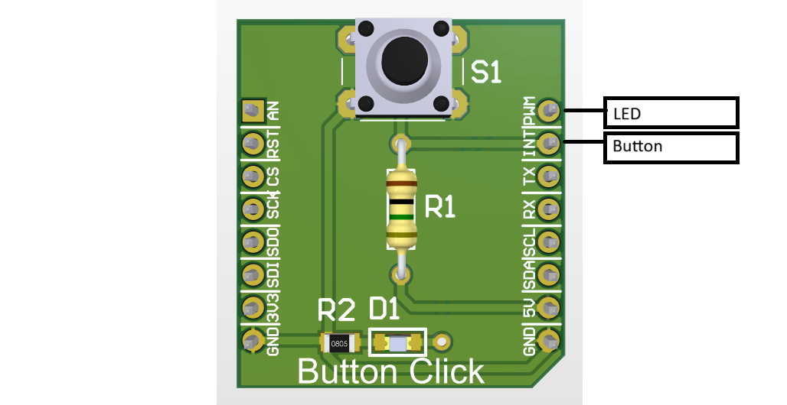

# myGPIO

Eenvoudige functies om LED's en knoppen aan te sturen op de ESP32-S3 Mini.

## Het board



> Plaats je foto van het board als `images/board.png` in deze map.

## Aansluitingen

Op het board (zie [myESP_S3_mini_board.h](../../boards/myESP_S3_mini_board/include/myESP_S3_mini_board.h)):

| Onderdeel | Pin | Define |
|---|---|---|
| LED | GPIO 4 | `MB_PWM_PIN` |
| Knop | GPIO 5 | `MB_INT_PIN` |

* **LED:** pin → weerstand → LED → GND. De pin geeft 3.3 V (`1`) om de LED aan te zetten.
* **Knop:** pin → knop → GND. Er is geen externe weerstand nodig, de interne pull-up wordt ingeschakeld.
  Een niet-ingedrukte knop leest dus `1`, een ingedrukte knop leest `0`.

## Hoe werkt het

### LED's

| Functie | Uitleg |
|---|---|
| `myGPIO_LED_Setup(pin)` | Zet de pin klaar als uitgang (met terugleesmogelijkheid) |
| `myGPIO_LED_SetValue(pin, value)` | Zet de pin op 0 of 1 |
| `myGPIO_LED_On(pin)` | LED aan |
| `myGPIO_LED_Off(pin)` | LED uit |
| `myGPIO_LED_Toggle(pin)` | Wisselt de toestand van de LED |

`Toggle` leest de huidige toestand van de pin en schrijft het omgekeerde terug.

### Knoppen

| Functie | Uitleg |
|---|---|
| `myGPIO_KNOP_Setup(pin)` | Zet de pin als ingang met interne pull-up |
| `myGPIO_KNOP_GetValue(pin)` | Geeft de huidige toestand: `1` = los, `0` = ingedrukt |
| `myGPIO_KNOP_GetFlank(pin)` | Geeft `1` op het moment dat de knop net ingedrukt wordt (dalende flank), anders `0` |
| `myGPIO_KNOP_SetupInterrupt(pin)` | Activeert een interrupt op de dalende flank |

`GetFlank` onthoudt per pin de vorige toestand. Roep de functie regelmatig op
(bv. elke 10 ms) en je krijgt maar één keer `1` per druk op de knop.

Bij `SetupInterrupt` moet je zelf de actie schrijven in `KNOP_ISR` in `myGPIO.c`. Hou ze kort.

## Voorbeeld

```c
myGPIO_LED_Setup(MB_PWM_PIN);
myGPIO_KNOP_Setup(MB_INT_PIN);

while (1) {
    if (myGPIO_KNOP_GetFlank(MB_INT_PIN)) {
        myGPIO_LED_Toggle(MB_PWM_PIN);
    }
    vTaskDelay(pdMS_TO_TICKS(10));
}
```

Een volledig voorbeeld staat in de map [example](example).
